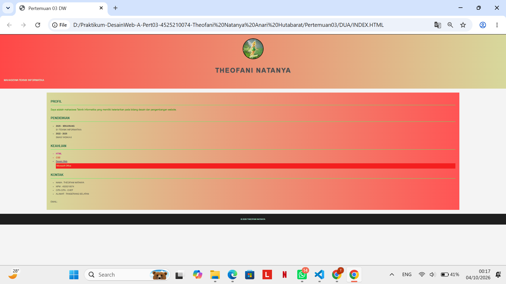
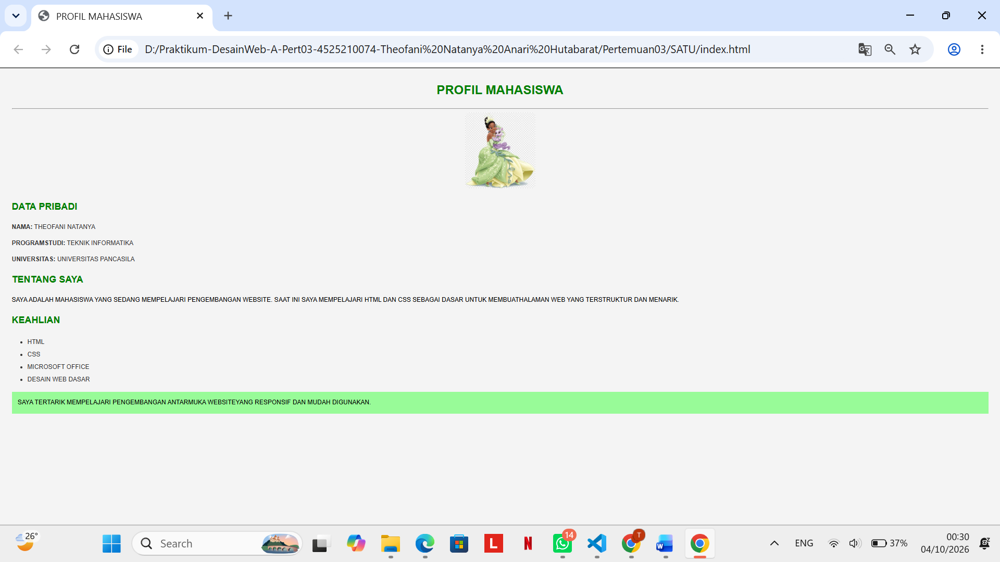
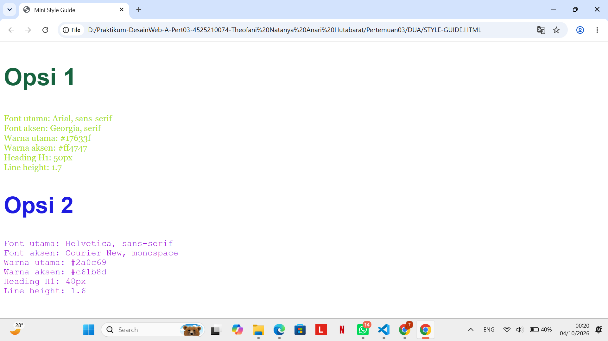

# Identitas #
- Nama: Theofani Natanya  
- NPM: 4525210074  
- Mata Kuliah: Praktikum Web Design - A 

# Deskripsi Proyek #
Proyek ini adalah pembuatan halaman CV menggunakan HTML dan CSS. Halaman berisi profil, pendidikan, keahlian, dan kontak. Selain itu ditambahkan :
1. 10 properti CSS inline.
2. 4 format warna berbeda.
3. Membuat ministyle guide berisi 2 opsi font warna utam, warna aksen, ukuran heading serta line height.  

# 10 Properti CSS inline : #
1. color
2. letter-spacing
3. text-shadow
4. text-transform
5. font-size
6. line-height
7. font-weight
8. font-style
9. text-decoration
10. background-color

# 4 Format warna berbeda : #
1. #ff4747  
2. #d7d89c  
3. #17633f  
4. #5af166  

# Mini Style Guide #
~ Opsi 1~
- Font utama: Arial, sans-serif  
- Font aksen: Georgia, serif  
- Warna utama: #17633f  
- Warna aksen: #ff4747  
- Heading H1: 50px  
- Line height: 1.7  
~ Opsi 2 ~
- Font utama: Helvetica, sans-serif  
- Font aksen: Courier New, monospace  
- Warna utama: #2a0c69  
- Warna aksen: #c61b8d  
- Heading H1: 48px  
- Line height: 1.6  

# Fitur Website
1. Menampilkan foto profil
2. Menampilkan data diri
3. Menampilkan riwayat pendidikan
4. Menampilkan daftar keahlian
5. Menampilkan informasi kontak
6. Menggunakan CSS eksternal
7. Menggunakan CSS inline
8. Menggunakan gradient background
9. Menggunakan hyperlink email

## Hasil Tampilan

## Kesimpulan
Website CV ini berhasil dibuat menggunakan HTML dan CSS dengan tujuan menampilkan informasi pribadi secara terstruktur, menarik, dan mudah dipahami. Dalam pengembangannya, HTML digunakan sebagai kerangka utama halaman, sedangkan CSS digunakan untuk mempercantik tampilan visual. Selain menggunakan CSS eksternal untuk mengatur desain secara keseluruhan, proyek ini juga menerapkan beberapa CSS inline untuk memberikan gaya khusus pada elemen tertentu. Desain website memanfaatkan kombinasi warna yang harmonis, tipografi yang jelas, serta efek gradient sehingga tampilan terlihat lebih modern dan nyaman dibaca. Halaman terdiri dari beberapa bagian utama, yaitu profil, pendidikan, keahlian, dan kontak yang memudahkan pengunjung memperoleh informasi secara cepat. Penggunaan gambar profil dan hyperlink email juga menambah fungsi interaktif pada website. Selain itu, pembuatan mini style guide membantu menentukan font, warna utama, warna aksen, ukuran heading, dan line height agar desain tetap konsisten. Pengujian dilakukan pada tampilan desktop dan mobile untuk memastikan website dapat ditampilkan dengan baik pada berbagai ukuran layar. Secara keseluruhan, proyek ini meningkatkan pemahaman mengenai HTML, CSS, struktur halaman web, serta dasar-dasar web design yang baik.